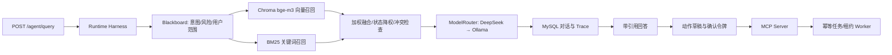

# CampusCopilot

面向商丘学院公开政策资料的校园政策检索与办事准备 Agent。主演示场景是奖学金申请，第二场景是转专业。系统只提供资料检索、适用范围提示和项目内部准备任务，不连接真实校务系统，也不会声称已经替学生提交申请。

## 已实现的完整链路

1. 用户通过 `/agent/query` 提问并提供年级、学院或目标专业。
2. Runtime Harness 完成领域路由、风险判断和请求级 Blackboard 初始化。
3. Chroma 特征哈希向量召回与 BM25 关键词召回并行，加权融合后进行状态降权和启发式过滤。
4. 回答同时返回来源 URL、资料范围、收录状态、效力未知项和版本冲突提示。
5. Redis 保存最近十条对话；不可用时回退 MySQL。较早消息可生成版本化 MemorySnapshot，确认事实可更新和撤销。
6. DeepSeek 与 Ollama/Qwen2.5:7B 通过统一 ModelRouter 接口调用，带 CLOSED/OPEN/HALF_OPEN 三态熔断。流式回答只允许在首 token 前切换提供方，输出后断流不会拼接另一个模型的答案。
7. 用户先创建动作草稿，再用与具体内容绑定的限时令牌显式确认。
8. 确认后由真实 MCP Client 调用 MCP Server 工具，幂等创建数据库任务。
9. Worker 通过数据库租约领取任务；generation 防止过期执行者覆盖接管后的新结果，失败可进入重试。
10. 奖学金问答完成证据与引用核验后，政策核查、准备规划、安全审查三个 Agent 顺序领取任务，最多执行三步；领取、成果、完成或失败事件追加到 BlackboardEvent。安全审查仅能关闭或保留动作建议，创建任务仍需草稿和用户确认。
11. ConversationRun 关联 RetrievalRun、ModelAttempt、BlackboardEvent 和 ActionTask，可通过 `/runs/{run_id}` 查看 Trace。

## 资料边界

知识库当前收录 5 个商丘学院官方页面、14 个可检索块。奖助学金页面存在历史金额差异，系统会展示冲突，不会只按发布日期自动认定哪一项当前有效。转专业通知属于 2024 级历史周期，当前办理时间必须查询当年新通知。

公开来源：

- https://www.sqxy.edu.cn/squ_zsb/contents/159/28136.html
- https://www.sqxy.edu.cn/squ_zsb/contents/158/5878.html
- https://www.sqxy.edu.cn/squ_xg/contents/1781/682.html
- https://www.sqxy.edu.cn/squ_xg/contents/1781/796.html
- https://www.sqxy.edu.cn/squ_xg/contents/1768/97.html

## Windows 日常运行与面试演示

**适用于当前已经配置好的电脑：一个 PowerShell 窗口运行网站，第二个窗口运行后台任务，再用浏览器操作。** 

这台电脑已有 Python 虚拟环境、数据库配置、本地模型和知识索引，日常启动不用重复安装依赖、下载模型、执行迁移或重新入库。保留已有 `.env`，不要用 `.env.example` 覆盖它。

### 1. 打开 PowerShell，进入项目目录

在 Windows 开始菜单搜索 **PowerShell** 并打开，复制下面的命令，按回车：

```powershell
cd "E:\download\shuijiabao\importSoft\codex_workspace\CampusCopilot\2026-09-14\x-z\work\campus_copilot"
```

`cd` 表示切换目录。正确目录中应有 `main.py`、`scripts` 和 `.venv`；它与外层的 `CampusCopilot` 文件夹不同。下面的启动命令都在这个目录执行。

各部分的作用如下：

| 服务 | 项目中的作用 | 本机启动方式 |
|---|---|---|
| MySQL，3306 | 保存完整对话、运行记录和准备任务 | Windows 服务 `MySQL80`，已设为自动启动 |
| Redis 兼容缓存，6380 | 缓存近期对话 | `start_cache.ps1` |
| Ollama，11434 | 本地 Embedding 检索和备用问答模型 | `start_ollama.ps1` |
| FastAPI，8000 | 提供网页和后端接口 | 第 3 步的 Python 命令 |
| Worker 后台执行器 | 完成用户确认后的内部准备清单 | 第 4 步在第二个窗口启动 |

Chroma 是项目内的持久化知识索引，由后端直接读取，不需要另外启动一个服务。

### 2. 第一个窗口：启动缓存和本地模型服务

依次执行：

```powershell
.\scripts\start_cache.ps1
.\scripts\start_ollama.ps1
```

看到 `started` 表示启动成功；看到 `already listening` 表示服务已经运行，也正常。两条命令完成后会返回 PowerShell 的输入提示，可以继续输入下一条命令。

当前配置为 `EMBEDDING_PROVIDER=ollama`，检索时要先把问题转换成向量，所以即使回答优先使用 DeepSeek，也需要启动本地 Ollama。DeepSeek 的实际调用还需要网络和有效的本地配置。

本机 MySQL 通常随 Windows 自动启动，无需另外打开数据库管理软件。若后面的运行检查显示 MySQL 不可用，参照下方故障表启动 `MySQL80`。

### 3. 第一个窗口：启动网站

继续执行：

```powershell
.\.venv\Scripts\python.exe -m uvicorn main:app --host 127.0.0.1 --port 8000
```

这里使用项目 `.venv` 中的 Python，确保使用已安装的项目依赖。`main:app` 对应 `main.py` 中的 FastAPI 应用；`127.0.0.1:8000` 是本机访问地址。

看到类似输出表示网站启动成功：

```text
Application startup complete.
Uvicorn running on http://127.0.0.1:8000
```

**窗口一直停在这里、没有返回输入提示是正常的，保持这个窗口打开。** 前端由同一个后端提供，无需安装 Node.js 或单独启动前端。

### 4. 第二个窗口：启动准备任务执行器

再打开一个 PowerShell 窗口。新窗口也要先进入项目目录，再启动 Worker：

```powershell
cd "E:\download\shuijiabao\importSoft\codex_workspace\CampusCopilot\2026-09-14\x-z\work\campus_copilot"
.\.venv\Scripts\python.exe -m scripts.run_worker --continuous
```

`--continuous` 表示持续等待并处理任务。这个窗口可能一直没有新输出，是在等待任务，保持打开即可。

只演示政策问答时，完成前 3 步就能使用；演示“确认后生成准备清单”时，需要同时运行 Worker。仅运行网站时，已创建的任务可能保持“待处理”。

### 5. 浏览器：检查与演示

打开以下本机地址：

- [项目页面](http://127.0.0.1:8000/)：日常操作和面试演示入口。
- [运行检查](http://127.0.0.1:8000/health/ready)：检查基础依赖。
- [Swagger 接口文档](http://127.0.0.1:8000/docs)：需要直接查看、调用 API 时使用。

运行检查的正常结果示例：

```json
{
  "status": "ready",
  "checks": {
    "mysql": "ok",
    "redis": "ok",
    "chroma": "ok"
  }
}
```

这个检查只做 MySQL 查询、Redis PING 和 Chroma 目录存在性检查，不验证模型调用或索引内容。Redis 不可用时会显示 `degraded`，项目可以回源 MySQL；面试前仍应实际问一次问题，确认完整问答可用。

建议按下面的顺序演示：

1. 点击示例问题“奖学金申请条件”。
2. 展开“适用范围”，核对年级、学院；转专业问题可填写“拟转入专业”。
3. 点击“发送问题”，等待回答，不连续重复提交。
4. 查看回答、参考来源及历史资料/待核实事项提示。
5. 查看右侧“本次运行记录”，说明检索、实际模型调用和执行步骤。数量以本次结果为准。
6. 出现“查看准备清单草稿”时，点击并核对内容，再明确确认创建任务；未出现时，先看回答中的适用范围或证据限制。
7. 等待任务更新为“已完成”，查看准备清单；也可以点击“刷新状态”。
8. 点击右上角“新对话”，开始新的演示。

页面使用非流式 `/agent/query`，等待完整回答后展示。浏览器演示标识用于关联会话，不是登录认证；确认令牌只保存在当前页面内存中。清单是项目内部准备任务，不会向学校提交申请或产生审批结果。

### 6. 使用完后停止

在网站和 Worker 两个窗口中，分别按 **Ctrl+C**，停止对应进程。只关闭浏览器不会停止后端或 Worker。

缓存和 Ollama 在后台运行，停止网站不会一起关闭它们。如需停止项目启动的 Ollama，在项目目录执行：

```powershell
.\scripts\stop_ollama.ps1
```

### 常见问题

| 现象 | 处理方式 |
|---|---|
| 找不到文件、`.venv` 或 `main` 模块 | 重新执行第 1 步的 `cd`，确认目录中有 `main.py`、`scripts` 和 `.venv` |
| 提示 8000 端口被占用或 `address already in use` | 先打开项目页面，确认是否已经有一份后端运行；需要重启时，在原来的后端窗口按 Ctrl+C，再启动 |
| 缓存/Ollama 脚本显示 `already listening` | 表示对应端口已经有服务监听，不需要反复启动 |
| 页面提示检索服务不可用 | 检查 Ollama 已启动，再执行 `.\scripts\ollama.ps1 list`，确认存在 `bge-m3`；同时查看后端窗口的错误信息 |
| 页面提示模型服务不可用 | 查看后端错误信息，检查网络、DeepSeek 配置及 Ollama 备用模型；不要把基础服务 `ready` 当成模型验证通过 |
| 准备清单一直“待处理” | 检查第二个窗口是否已启动 Worker；有错误时先处理错误，再刷新任务 |
| 运行检查显示 MySQL 不可用 | 按 Win+R，输入 `services.msc`，找到 `MySQL80` 并启动，再刷新检查 |
| 网站能打开但回答没有有效来源 | 查看证据不足、年份或范围提示；这不一定是启动故障，历史资料不能证明当年政策 |

如果 PowerShell 提示“禁止运行脚本”，在当前窗口执行下面的命令，然后重试启动脚本：

```powershell
Set-ExecutionPolicy -Scope Process -ExecutionPolicy Bypass
```

这个设置仅对当前 PowerShell 窗口生效，不修改系统的长期策略。

### 环境重建参考（已有环境日常不用执行）

<details>
<summary>展开查看虚拟环境、配置、模型、迁移与知识入库步骤</summary>

以下步骤以已经具备 MySQL 数据库/账户、缓存可执行文件和项目便携版 Ollama 为前提；换电脑时需要先准备这些依赖。仍在本 README 所在目录操作。

1. 需要重建 Python 环境时，创建虚拟环境并安装依赖：

   ```powershell
   python -m venv .venv
   .\.venv\Scripts\python.exe -m pip install -r requirements.txt
   ```

2. 仅在 `.env` 不存在时复制示例文件，再填写数据库密码和所选模型配置：

   ```powershell
   if (-not (Test-Path -LiteralPath .env)) {
       Copy-Item .env.example .env
   }
   ```

3. 启动缓存和 Ollama，查看已有模型；仅缺少模型时执行对应的 `pull`：

   ```powershell
   .\scripts\start_cache.ps1
   .\scripts\start_ollama.ps1
   .\scripts\ollama.ps1 list
   ```

   ```powershell
   .\scripts\ollama.ps1 pull qwen2.5:7b
   .\scripts\ollama.ps1 pull bge-m3
   ```

4. 数据库需要升级或首次建表时执行迁移；首次准备知识索引、更新资料或调整 Embedding 配置后重新入库：

   ```powershell
   .\.venv\Scripts\alembic.exe upgrade head
   .\.venv\Scripts\python.exe -m scripts.ingest_knowledge
   ```

完成后按上面的日常流程启动网站和 Worker。修改 Python 代码时，也可在开发阶段给 Uvicorn 命令添加 `--reload` 自动重载。

缓存脚本依次查找 `CAMPUS_CACHE_SERVER`、已忽略提交的 `config/cache-server.path`、项目内/PATH 中的 `redis-server.exe`，最后尝试 Memurai；开发缓存固定监听 6380。项目便携版 Ollama 位于 `tools/ollama/runtime`，程序状态、模型、临时文件和日志保存在已忽略提交的 `data/ollama`。

</details>

## 模型配置

- `MODEL_PROVIDER=deepseek`：使用现有 DeepSeek API。
- `MODEL_PROVIDER=ollama`：只使用本地 Ollama，默认模型 `qwen2.5:7b`。
- `MODEL_PROVIDER=router`：优先 DeepSeek，首 token 前失败时尝试 Ollama。
- `MODEL_PROVIDER=mock`：离线开发基线；Agent 主流程使用证据模板回答，不冒充真实模型验证。

`EMBEDDING_PROVIDER=hash` 使用可复现的离线基线；安装并拉取 `bge-m3` 后可改为 `EMBEDDING_PROVIDER=ollama`，生成模型与嵌入模型分别配置。

密钥只放在本地 `.env`，不得提交。`/health/ready` 检查 MySQL、Redis 和 Chroma；Redis 不可用被标为降级，不会把持久化数据当作丢失。

## 验证

```powershell
.\.venv\Scripts\python.exe -m pytest -q
.\.venv\Scripts\python.exe -m scripts.evaluate_retrieval
.\.venv\Scripts\python.exe -m scripts.evaluate_retrieval_v1
.\.venv\Scripts\python.exe -m scripts.check_answerability_v1
.\.venv\Scripts\python.exe -m scripts.check_unanswerable_agent_v1
.\.venv\Scripts\python.exe -m scripts.check_memory_benefit_v1
.\.venv\Scripts\python.exe -m scripts.check_memory_real_summary_v1
.\.venv\Scripts\python.exe -m scripts.check_action_flow
.\.venv\Scripts\python.exe -m scripts.check_manual_recovery
.\.venv\Scripts\python.exe -m scripts.check_agent_flow
.\.venv\Scripts\python.exe -m scripts.check_provider_trace
.\.venv\Scripts\python.exe -m scripts.check_http_e2e
.\.venv\Scripts\python.exe -m scripts.check_classification_model_v1
$env:MODEL_PROVIDER='ollama'; .\.venv\Scripts\python.exe -m scripts.check_classification_agent_v1
.\.venv\Scripts\python.exe -m scripts.capture_reproduction
```

阶段⑦的综合验收顺序、结果及边界见`../../outputs/CampusCopilot_阶段7综合复现与串讲.md`。`capture_reproduction`校验v1冻结资料与题目，记录源码文件SHA-256、依赖版本和不含凭证值的配置快照；它不重跑检索指标或Memory收益。

检索评测旧集合共 26 条，原调参集与留出集分开。2026-09-18 使用真实 `bge-m3` 重建索引后，旧脚本记录的 `recall_at_5=1.0000` 实际计算的是 Hit Rate@5（至少命中一个相关块的题目比例），不能称为真正的 Recall@5。旧向量、BM25、混合 MRR 分别为 0.7788、0.8974、0.9006；混合检索只比 BM25 高 0.0032，不夸大为显著提升。留出集 MRR 分别为 0.7500、0.7949、0.8013。旧结果保存在 `data/evaluation/latest_results.json`，仅供历史对照。

2026-09-24起，`scripts.evaluate_retrieval`按每题“前5条命中的不同相关块数÷该题全部相关块数”计算真正Recall@5；无相关块题目单列计数，不进入Recall/MRR分母。旧集重跑结果在`data/evaluation/legacy_corrected_results.json`，明确标记`legacy_exploratory_not_frozen`，不能与不同Embedding配置的历史结果直接比较。

新版`data/evaluation/v1`固定开发/回归集有6源19块、39题，36题有相关块；新增资料后旧26题已对全部19块重新标注，`manifest.json`锁定资料和题目。真实Ollama Embedding下，BM25/向量/Hybrid的Recall@5依次为0.9563/0.9647/0.9841，MRR为0.8667/0.8125/0.8861；本机单请求检索P95为3.63/946.90/1325.71毫秒。结果见`results_ollama.json`。该集合已参与规则调整，且没有第二人复核，不是独立测试集或线上效果。

同一v1集合的证据过滤检查保留36道有相关块题，拦下3道无相关块题；实际Ollama Embedding、MySQL及进程内HTTP专项检查中，三道题的原始候选数为5、5、0，均返回证据不足、有效引用0、模型调用记录0。分别见`answerability_guard_results_ollama.json`和`unanswerable_agent_check.json`。过滤规则只排除明确年份缺失或明显主题不符；引用编号检查与少量年级/金额字面核对不能证明整段回答得到资料支持。2026-09-26最新全量自动测试70项通过、1条第三方依赖弃用警告。本地Ollama完整生成另用默认120秒上限，DeepSeek仍用30秒；本机真实正常问答约94秒完成，不能外推为端到端性能保证。

Memory固定24条消息样例见`scripts.check_memory_benefit_v1`和`data/evaluation/memory_v1_results.json`：真实MySQL中注入一次摘要失败，快照数仍为0；重试得到v1，新增消息后增量得到v2；确认事实更新/撤销后仅保留生效项。使用固定摘要器时，完整历史与“最近10条＋摘要＋生效事实”的问答模型输入内容字符数为968→709，减少26.76%；这不是模型生成质量结论。最新真实本地Ollama两轮摘要报告为`memory_v1_real_summary_ollama.json`，相同口径968→812字符，减少16.12%。首次真实摘要曾丢掉“2026年截止日未确认”状态，保留在`memory_v1_real_summary_ollama_before_prompt.json`；第一次调提示后得到的968→810结果保留在`memory_v1_real_summary_ollama_before_amount_prompt.json`，该次仍漏掉旧金额限制。第二次调提示后，最新摘要保留截止日待核对与旧金额不能作为目标年度标准，但没有逐年分开表述2024/2025档次。字符数不是token数或费用；同题调提示的单样例不能代表一般收益或自动保证事实正确。

Agent问答的`ConversationRun.blackboard_json.memory`现在记下读取的快照ID、版本、已覆盖消息边界、生效事实键、近期消息数和`used_in_model_context`。固定样例在真实MySQL与进程内`GET /runs/{run_id}`验证v2被注入式回答生成器使用；该生成器不是实际模型服务。零证据安全拒答或Router没有实际Provider尝试时，即使读过快照，`used_in_model_context`仍为false。`scripts.check_provider_trace`的测试检索资料也已适配新的证据过滤规则，故障注入复跑仍得到DeepSeek失败、Ollama成功的两条逐次记录。

新版阶段④在有可用回答证据时增加模型结构化意图与风险建议：模型仅输出`intent/risk_level`，Pydantic拒绝非法JSON、缺字段、额外字段和非法枚举；模型识别可辅助问答主题，但已被关键词规则识别的主题不会被改写，风险只取程序规则与模型建议中较高的一档。`can_create_task`仍要求程序规则识别出受支持主题、资料与范围条件合格，动作最终还需草稿及用户确认。无可用证据时分类和回答模型均跳过；分类调用失败或结构非法时回退程序规则。Blackboard记分类状态，`ModelAttempt.operation`区分`classification`和`answer`。真实本地Ollama两个固定问题均输出合法JSON并判对主题，但把“创建奖学金准备清单”风险报为`LOW`；程序最终为`HIGH`。真实MySQL、Ollama Embedding与回答、进程内HTTP Trace的专项结果在`data/evaluation/classification_agent_v1_ollama.json`：同一run下分类与回答各一次成功尝试，有效引用0，`can_create_task=false`，未创建动作。故障矩阵用模拟Provider验证，不能称真实服务商故障实测；该样例不能代表风险识别准确率。

## 核心调用链



## 主要接口

- `POST /agent/query`：有来源的政策问答和适用范围判断。
- `POST /chat`、`POST /chat/stream`：非流式与 SSE 流式多轮聊天。
- `GET/POST/DELETE /conversations/...`：长期记忆、确认事实和撤销。
- `POST /actions/drafts`：生成待确认的准备任务草稿。
- `POST /actions/confirm`：确认并通过 MCP 幂等创建任务。
- `GET /actions/tasks/{task_id}`：查询任务状态与结果。
- `GET /actions/manual/tasks`：持管理凭证查看待人工处理任务。
- `GET /actions/manual/tasks/{task_id}`：查看任务原始内容、失败状态与人工操作记录。
- `POST /actions/manual/tasks/{task_id}/resume`：附原因恢复原内容任务；只接受`MANUAL_REVIEW`。
- `POST /actions/manual/tasks/{task_id}/cancel`：附原因终止未完成任务，包括执行中任务。
- `POST /actions/worker/run-once`：演示领取并完成一个任务。
- `GET /runs/{run_id}`：查看检索、模型和动作 Trace。

## 诚实说明

- `ACTIVE/STALE` 表示项目对资料的收录维护状态，不等于政策生效或废止。
- 特征哈希嵌入是无网络、可复现的本地检索基线，不冒充语义大模型嵌入；Chroma 的索引与向量查询是真实运行的。
- DeepSeek、Ollama、MySQL、Redis、MCP 等分别记录真实验证状态；Mock 测试不能替代外部依赖集成证明。
- 当前 Windows 缓存实测为 Redis 5.0.14.1 兼容服务，不冒充官方 Linux Redis；Memurai 仍可作为另一兼容实现。
- 任务结果是内部准备清单，不具有学校审批、提醒或对外发送能力。
- 人工处理接口默认关闭；在服务端`.env`设置至少32字符的随机`MANUAL_OPERATOR_TOKEN`及`MANUAL_OPERATOR_ID`后，请求使用`Authorization: Bearer <token>`。身份和审计操作者由服务端配置确定，请求中的`user_id`、`run_id`或自报`operator_id`均不授予管理权限。该配置只支持一个演示操作者，不是多用户登录或生产权限系统。
- 人工恢复只重置本轮`retry_attempts`，累计`attempts`和`generation`继续增长；修改动作内容必须重新创建草稿并取得用户确认。恢复、终止与操作记录在同一数据库事务提交；终止执行中任务会失效旧租约，旧Worker不能回写。
